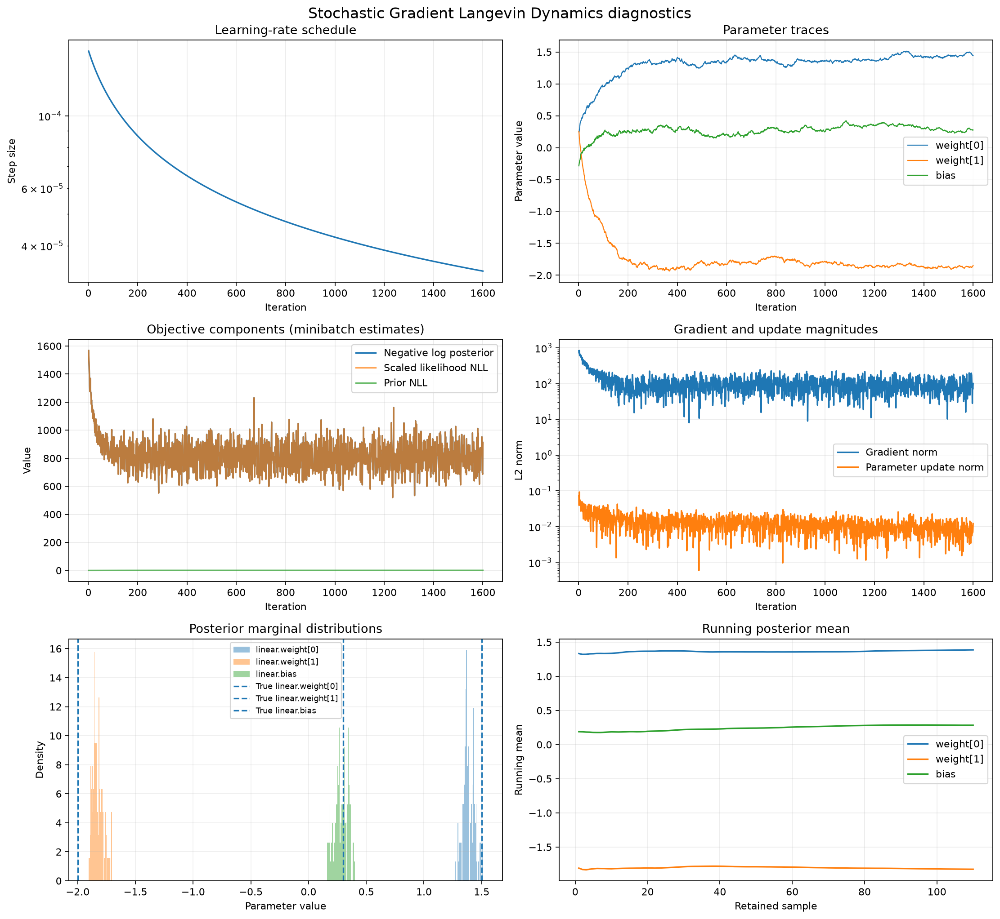
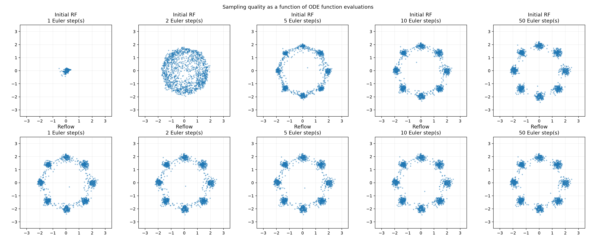

# AI assisted research

## Stochastic Gradient Langevin Dynamics

The paper [“Bayesian Learning via Stochastic Gradient Langevin Dynamics”](https://www.stats.ox.ac.uk/~teh/research/compstats/WelTeh2011a.pdf), introduces SGLD, a method that combines stochastic-gradient updates with appropriately scaled Gaussian noise to draw approximate samples from a Bayesian posterior. Its use of minibatches makes posterior inference practical for large datasets, while decreasing the step size over time supports convergence to the target distribution.

For a dataset of $N$ observations and a minibatch $B_t$ of size $n$, the update is

$$
\theta_{t+1} = \theta_t + \frac{\epsilon_t}{2}\left(\nabla_\theta \log p(\theta_t) + \frac{N}{n}\sum_{x_i \in B_t}\nabla_\theta \log p(x_i \mid \theta_t)\right) + \eta_t,\qquad \eta_t \sim \mathcal{N}(0, \epsilon_t I).
$$

Here, $\epsilon_t$ is the step size; the minibatch gradient is scaled by $N/n$, and the Gaussian noise has covariance $\epsilon_t I$.

## Rectified Flow

The paper [“Flow Straight and Fast: Learning to Generate and Transfer Data with Rectified Flow”](https://arxiv.org/pdf/2209.03003) proposes rectified flow, a generative modeling approach that learns to transport samples from a source distribution to a target distribution along nearly straight trajectories. It constructs linear interpolations between paired samples and trains a time-dependent velocity field to follow the endpoints’ displacement. Repeated rectification can straighten the trajectories further, reducing the number of numerical integration steps needed during sampling.

Given source samples $X_0 \sim p_0$, target samples $X_1 \sim p_1$, and the linear interpolation $X_t=(1-t)X_0+tX_1$, rectified flow learns a velocity field $v_\theta(X_t,t)$ with

$$
\min_\theta \mathbb{E}_{X_0,X_1,t}\left[\left\|v_\theta(X_t,t)-(X_1-X_0)\right\|^2\right],
\qquad
\frac{dX_t}{dt}=v_\theta(X_t,t).
$$

Here, $X_1-X_0$ is the target direction for each interpolation, and the learned ODE transports $X_0$ toward $X_1$.

